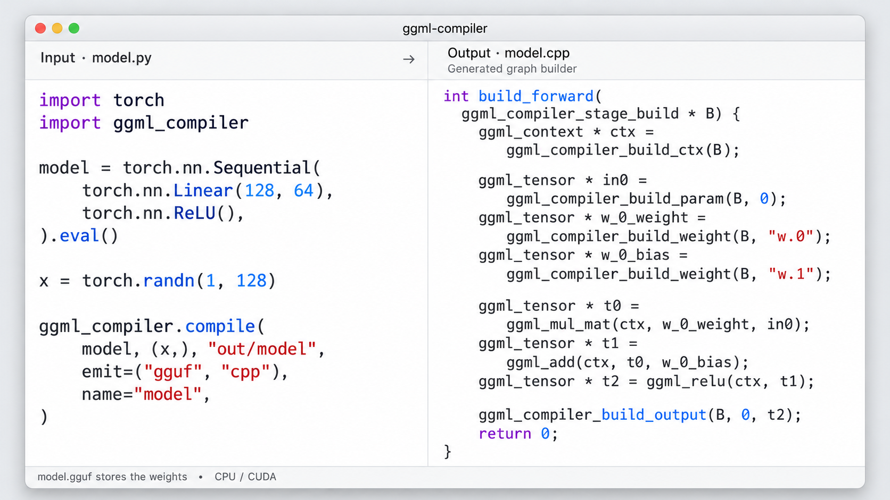

# ggml-compiler

<p align="center">
  
</p>

ggml-compiler compiles PyTorch and ONNX models into [ggml](https://github.com/ggml-org/ggml)
programs that run on CPU and CUDA without Python. It targets LLMs, vision-language models and the
robot policies built on them.

<p align="center">
  
</p>

## Installation

### Using pip

The prebuilt wheel includes the CPU runtime for Linux x86-64 with AVX2. It requires Python 3.10
or newer:

```bash
pip install ggml-compiler
```

For LLM/VLM support through `ggml_compiler.causal_lm`, install the Transformers extra:

```bash
pip install "ggml-compiler[llm]"
```

For CUDA, build the release from source with CMake 3.22 or newer, a C++17 compiler, and the CUDA
toolkit. This downloads ggml during the build:

```bash
pip install ggml-compiler --no-binary ggml-compiler -C cmake.define.GGML_CUDA=ON
```

For either installation method, set `GGML_COMPILER_RT` to the path of a runtime library if you
want to use a build stored elsewhere.

### From source

Use a checkout for development, examples, and tests. You need Python 3.12 for the LeRobot reference
models, [uv](https://docs.astral.sh/uv/), CMake 3.22 or newer, and a C++17 compiler.

```bash
git clone https://github.com/khanhnd61-vr/ggml-compiler
cd ggml-compiler
uv sync --all-extras
```

To skip the LeRobot reference models, use `uv sync --all-extras --no-group parity` instead.

Build the CPU runtime:

```bash
cmake -S runtime -B build -DCMAKE_BUILD_TYPE=Release
cmake --build build -j
```

Or build with CUDA support (requires the CUDA toolkit; replace `86` with your GPU's compute
capability). This runtime also supports CPU execution:

```bash
cmake -S runtime -B build-cuda -DCMAKE_BUILD_TYPE=Release \
  -DGGML_CUDA=ON -DCMAKE_CUDA_ARCHITECTURES=86
cmake --build build-cuda -j
```

The first configure downloads ggml (llama.cpp tag b11223) into `.deps/`. Python sessions and the
CLI automatically find `build-cuda/libggml_compiler_rt.so`, then `build/libggml_compiler_rt.so`.
Run commands from the checkout with `uv run ggml-compiler`.

## Documentation

| Document | Contents |
|---|---|
| [docs/USAGE.md](https://github.com/khanhnd61-vr/ggml-compiler/blob/main/docs/USAGE.md) | API, CLI, codegen, quantization and other advance optimizations. |
| [docs/MODELS.md](https://github.com/khanhnd61-vr/ggml-compiler/blob/main/docs/MODELS.md) | List of tested models with their accuracy and speed against their references. |
| [docs/EXPORT.md](https://github.com/khanhnd61-vr/ggml-compiler/blob/main/docs/EXPORT.md) | How to write export script to compile a Pytorch model to ggml C++ source. |
| [docs/ARCHITECTURE.md](https://github.com/khanhnd61-vr/ggml-compiler/blob/main/docs/ARCHITECTURE.md) | How it works: the IR, frontends, passes, GGUF format and runtime internals. |
| [docs/OPS.md](https://github.com/khanhnd61-vr/ggml-compiler/blob/main/docs/OPS.md) | List of supported and un-supported Pytorch/ONNX operations. |

## License

[Apache License 2.0](https://github.com/khanhnd61-vr/ggml-compiler/blob/main/LICENSE).
